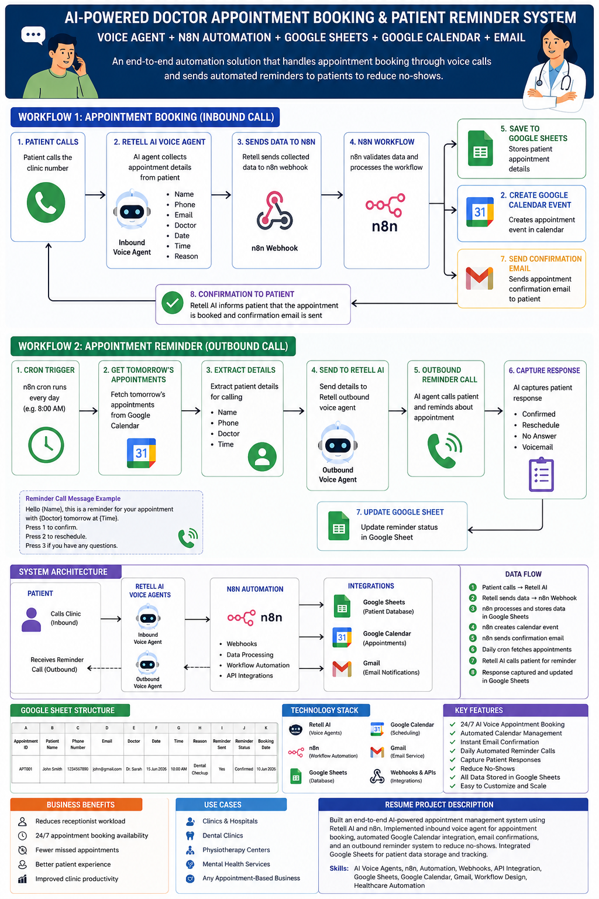

AI-Powered Doctor Appointment Booking & Patient Reminder System 

 

1. Project Overview 

An end-to-end healthcare voice automation solution that enables patients to book appointments through an AI voice agent and receive automated appointment reminders before their scheduled visit. 

The system uses Retell AI, n8n, Google Sheets, Google Calendar, and Email Notifications to automate the entire appointment lifecycle without human intervention. 

 

2. Problem Statement 

Healthcare clinics spend significant time handling appointment booking calls, updating schedules, and manually reminding patients about upcoming appointments. 

Common challenges include: 

Missed appointments 

Double bookings 

Manual calendar management 

Administrative workload 

Inefficient reminder processes 

This project automates appointment scheduling and reminder calls using AI voice agents. 

 

3. Solution 

The solution consists of two automated workflows: 

Workflow 1: Appointment Booking Voice Agent 

Patients call the clinic. 

The AI voice agent: 

-Greets the patient 

-Collects patient details 

-Checks appointment availability 

-Books appointment 

-Creates calendar event 

-Sends confirmation email 

-Stores patient information 

Workflow 2: Appointment Reminder Voice Agent 

-Before the appointment date: 

-System identifies upcoming appointments 

-AI voice agent calls patients 

-Reminds them about their appointment 

-Confirms attendance 

-Updates reminder status 

 

4. Technology Stack 

Component 

Tool ->Voice Agent Retell AI 

Workflow Automation ->n8n 

Database ->Google Sheets 

Scheduling ->Google Calendar 

Email Service ->Gmail 

APIs ->Retell API 

Webhooks ->n8n Webhooks 

 

5. System Architecture 

PATIENT 
 
   │ 
   ▼ 
 
Retell AI Voice Agent 
 
   │ 
   ▼ 
 
n8n Webhook 
 
   │ 
   ├────────────► Google Sheets 
   │               Save Patient Data 
   │ 
   ├────────────► Google Calendar 
   │               Create Appointment 
   │ 
   └────────────► Gmail 
                   Send Confirmation 
 
------------------------------------------------ 
 
Google Calendar 
 
   │ 
   ▼ 
 
n8n Scheduler 
 
   │ 
   ▼ 
 
Fetch Tomorrow's Appointments 
 
   │ 
   ▼ 
 
Retell AI Outbound Call 
 
   │ 
   ▼ 
 
Patient Reminder Call 
 
   │ 
   ▼ 
 
Google Sheets Update 
Reminder Sent = Yes 
 

 

6. Workflow 1: Appointment Booking 

Objective 

Automate doctor appointment booking through voice interaction. 

 

Detailed Flow 

Step 1 

Patient calls clinic number. 

 

Step 2 

Retell AI Voice Agent collects: 

Patient Name 

Phone Number 

Email 

Preferred Date 

Preferred Time 

Doctor Name 

Reason for Visit 

 

Step 3 

Retell sends data to n8n webhook. 

{ 
  "patient_name":"John Smith", 
  "phone":"123456789", 
  "email":"john@gmail.com", 
  "doctor":"Dr. Sarah", 
  "date":"2026-06-15", 
  "time":"10:00 AM", 
  "reason":"Dental Checkup" 
} 
 

 

Step 4 

n8n validates data. 

Checks: 

Required fields available 

Date format valid 

Time slot valid 

 

Step 5 

Store data in Google Sheets. 

Example: 

Name 

Phone 

Email 

Doctor 

Date 

Time 

John 

123 

john@gmail.com 

Dr Sarah 

15 Jun 

10 AM 

 

Step 6 

Create Google Calendar Event. 

Example: 

Appointment: 
John Smith 
 
Doctor: 
Dr Sarah 
 
Date: 
15 June 
 
Time: 
10 AM 
 

 

Step 7 

Send Confirmation Email. 

Example: 

Subject: 
Appointment Confirmed 
 
Hello John, 
 
Your appointment with Dr Sarah has been confirmed. 
 
Date: 15 June 
Time: 10 AM 
 
Thank you. 
 

 

Step 8 

Retell AI informs patient: 

"Your appointment has been successfully booked and a confirmation email has been sent." 

 

7. Workflow 2: Appointment Reminder 

Objective 

Reduce missed appointments through automated reminder calls. 

 

Trigger 

n8n Cron Node runs daily. 

Example: 

Every day 
8:00 AM 
 

 

Flow 

Step 1 

Cron Node triggers. 

 

Step 2 

Read Google Calendar. 

Fetch: 

Tomorrow's appointments 
 

 

Step 3 

Extract: 

Patient Name 

Phone Number 

Appointment Time 

Doctor Name 

 

Step 4 

Send appointment details to Retell AI. 

 

Step 5 

Retell places outbound call. 

Example: 

Hello John. 
 
This is a reminder for your appointment with Dr Sarah tomorrow at 10 AM. 
 
Press 1 to confirm. 
Press 2 to reschedule. 
 

 

Step 6 

Capture call result. 

Possible outcomes: 

Confirmed 

No Answer 

Voicemail 

Reschedule Requested 

 

Step 7 

Update Google Sheet. 

Patient 

Reminder Status 

John 

Confirmed 

 

8. n8n Workflow Design 

Booking Workflow 

Webhook 
 
 ↓ 
 
Set Node 
 
 ↓ 
 
Google Sheets 
 
 ↓ 
 
Google Calendar 
 
 ↓ 
 
Gmail 
 
 ↓ 
 
HTTP Response 
 

 

Reminder Workflow 

Cron Trigger 
 
 ↓ 
 
Google Calendar 
 
 ↓ 
 
Code Node 
 
 ↓ 
 
Loop Over Items 
 
 ↓ 
 
Retell API 
 
 ↓ 
 
Google Sheets Update 
 

 

9. Google Sheet Structure 

Column 

Appointment ID 

Patient Name 

Phone Number 

Email 

Doctor 

Appointment Date 

Appointment Time 

Reason 

Reminder Sent 

Reminder Status 

Booking Date 

 

10. Retell AI Features Used 

Inbound Agent 

Appointment booking 

Information collection 

Confirmation response 

Outbound Agent 

Reminder calls 

Appointment confirmation 

Reschedule handling 

 

11. Key Features 

Appointment Booking 

✅ Voice-based booking 

✅ Calendar integration 

✅ Email confirmation 

✅ Patient database 

✅ Automated scheduling 

 

Reminder System 

✅ Automated outbound calls 

✅ Daily reminder workflow 

✅ Attendance confirmation 

✅ Google Sheet updates 

✅ Missed appointment reduction 

 

12. Business Benefits 

Clinic 

Reduced receptionist workload 

24/7 appointment booking 

Fewer no-shows 

Better schedule management 

Patients 

Faster booking 

Instant confirmation 

Appointment reminders 

Improved experience 

 

13. Resume Project Description 

AI-Powered Healthcare Voice Automation System 

Built an end-to-end healthcare appointment management solution using Retell AI, n8n, Google Sheets, Google Calendar, and Gmail. Developed an AI voice agent capable of handling inbound appointment bookings, storing patient information, creating calendar events, and sending automated confirmation emails. Implemented a second workflow for automated appointment reminder calls using outbound AI voice agents, reducing missed appointments and improving operational efficiency. Designed scalable webhook-based architecture integrating voice AI, workflow automation, scheduling, and patient tracking systems. 

Skills Demonstrated 

-AI Voice Agent Development 

-Retell AI 

-n8n Automation 

-Webhooks & APIs 

-Google Calendar Integration 

-Google Sheets Database 

-Gmail Automation 

Workflow Design 

Healthcare Process Automation 

 

 
